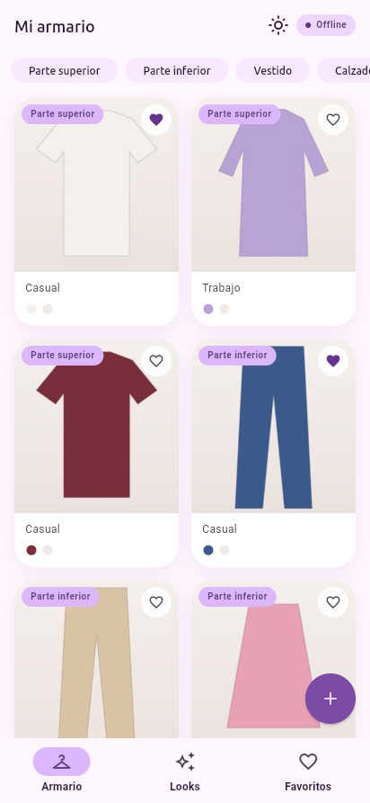
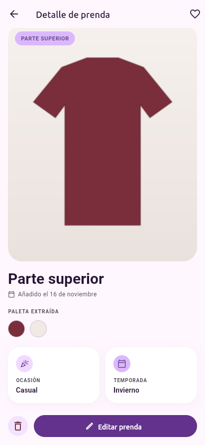
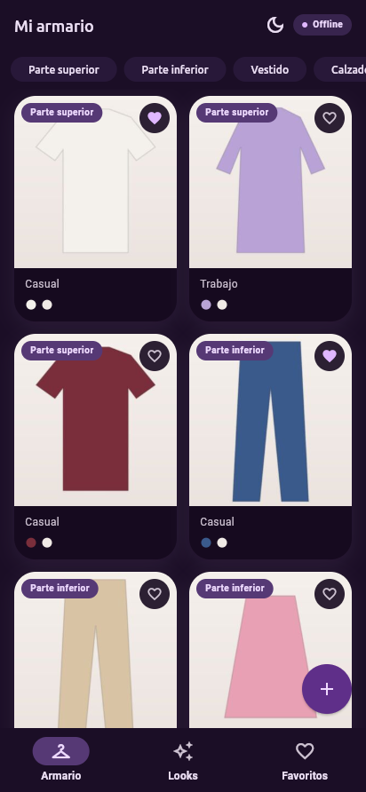
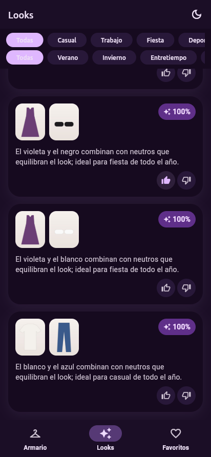
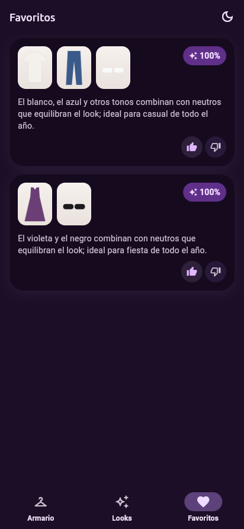

# Mi Armario

Armario digital para Android, pensado para una sola persona. Fotografías tu ropa, la app detecta sus colores y te propone combinaciones (looks) que aprende de lo que te gusta.

Todo funciona **sin conexión**: no hay servidor, cuentas, anuncios ni inteligencia artificial en la nube. Las fotos y los datos se guardan solo en el teléfono.

> Nombre interno del proyecto: **Leah**. El paquete Dart se llama `mi_armario`.

<p align="center">
  
  
  
</p>
<p align="center">
  
  
</p>

<sub>Capturas reales de la vista previa de escritorio con un armario de ejemplo (prendas dibujadas, no fotos).</sub>

## Qué hace

- **Armario**: añade prendas con la cámara o la galería. Cada prenda tiene categoría (parte superior, parte inferior, vestido, calzado, abrigo, accesorio), ocasión (casual, trabajo, fiesta, deporte), temporada (verano, invierno, entretiempo, todo el año) y notas. Se puede filtrar, editar, borrar y marcar como favorita.
- **Looks**: sugiere hasta 20 combinaciones ordenadas por puntuación, con una explicación en español de por qué combinan. Se pueden filtrar por ocasión y temporada.
- **Feedback**: cada look tiene 👍 / 👎. Los votos ajustan las sugerencias futuras.
- **Favoritos**: los looks que te han gustado.
- **Tema** claro, oscuro o el del sistema, desde el botón de la barra superior. La elección se guarda.

## Cómo se generan los looks

El motor es Dart puro (`lib/domain/outfit/`), sin red ni modelos de IA. Son reglas de color clásicas más un pequeño ajuste según tus votos.

### 1. El color de cada prenda

Al guardar una foto, [`palette_generator`](https://pub.dev/packages/palette_generator) analiza la imagen y devuelve sus colores más frecuentes. La app guarda los **5 con más peso** (la proporción de la foto que ocupan). El de mayor peso es el **color dominante** de la prenda y es el que usa el motor (`lib/data/services/palette_extractor.dart`).

Consejo: fotografía la prenda sobre un fondo liso y que ocupe casi toda la imagen. Si no, el fondo puede "ganar" como color dominante.

### 2. Todas las combinaciones posibles

Con las prendas que pasan los filtros de ocasión y temporada, se generan todas las combinaciones de estas formas:

- parte superior + parte inferior (+ calzado opcional) (+ abrigo opcional)
- vestido (+ calzado opcional) (+ abrigo opcional)

Los accesorios todavía no entran en los looks.

### 3. Puntuar cada pareja de colores

Para cada par de prendas del look se comparan sus colores dominantes en **HSL** (tono, saturación, luminosidad). El tono es un ángulo en la rueda de color (0–360°), así que lo importante es la distancia entre los dos tonos:

| Tipo | Cuándo | Idea |
|---|---|---|
| **Neutro** | uno de los dos es blanco, negro, gris o muy apagado | combina con todo |
| **Monocromático** | tonos a menos de 15° | el mismo color en distintas intensidades |
| **Análogo** | tonos a menos de 40° | vecinos en la rueda (azul y turquesa) |
| **Complementario** | tonos a 150–180° | opuestos que se realzan (azul y naranja) |
| **Tríada** | tonos a unos 120° (100–140°) | tres puntos equilibrados de la rueda |
| **Choque** | el resto, sobre todo dos colores muy saturados a media distancia | suele chirriar |

Cada tipo tiene una nota (de 0,9 en monocromático a 0,25 en choque). La puntuación del look es la media de sus pares más unos **bonus**:

- hay algún par con un neutro;
- todas las prendas son de la **misma ocasión**;
- todas las prendas son de **temporadas compatibles** ("todo el año" vale para cualquiera);

y unas **penalizaciones** por cada par que choca o con tonos casi iguales pero no idénticos (15–30°, que suelen parecer un error). El resultado se acota entre 0 y 100 %.

### 4. Aprender de tus votos

Cada 👍 / 👎 se guarda. Con ese historial (`weight_learning.dart`) la app mira qué rasgos tenían los looks que te gustaron y los que no (neutros, choques, tonos parecidos, misma ocasión, misma temporada) y sube o baja el peso de cada bonus o penalización. Por ejemplo, si apruebas a menudo looks con choques de color, la penalización por choque baja.

Para que unos pocos votos no lo desbaraten todo, cada peso queda **acotado entre 0,3× y 1,7×** de su valor original. Los pesos no se almacenan: se recalculan desde el historial cada vez, así que siempre son explicables.

### 5. Ocultar lo que no te gusta

Los looks cuyo último voto es 👎 no vuelven a aparecer en las sugerencias. Si cambias de opinión, basta con que el último voto sea 👍.

## Tecnología

| | |
|---|---|
| Framework | Flutter (CI con 3.44.9), Dart ^3.9, Material 3 |
| Estado | `flutter_riverpod` |
| Datos | SQLite con `sqflite` (migraciones versionadas, esquema v2) |
| Fotos | `image_picker` + `flutter_image_compress` (foto ~1080 px y miniatura ~300 px en JPEG) |
| Color | `palette_generator` |
| Diseño | sistema "Coquette Violette" (`design/coquette_violette/DESIGN.md`) |
| Tests | `flutter_test` + `sqflite_common_ffi` (SQLite en memoria, sin dispositivo) |

## Estructura

```
lib/
  main.dart, app.dart          # arranque, MaterialApp, temas
  core/theme/                  # paleta y tipografía Coquette Violette
  domain/                      # Dart puro, sin Flutter
    models/                    # Garment, Outfit, OutfitFeedback, enums con etiquetas en español
    color/color_math.dart      # RGB → HSL, distancia de tono, ¿es neutro?
    outfit/                    # motor: generar, puntuar, explicar, aprender pesos
    wardrobe/                  # filtros del armario
  data/
    db/                        # apertura de SQLite y migraciones
    repositories/              # prendas, feedback, ajustes
    services/                  # guardado de imágenes, extracción de paleta
  presentation/
    navigation/                # NavigationBar: Armario / Looks / Favoritos
    providers/                 # providers de Riverpod
    screens/, widgets/
tool/preview_desktop.dart      # entrada para la vista previa en Linux
test/                          # tests de dominio y repositorios
design/                        # maquetas de Stitch y sistema de diseño
android/                       # proyecto Android (applicationId com.leah.app)
```

El código está en inglés; los textos de la interfaz, en español.

## Ejecutar

Requisitos: Flutter estable (3.44.x) y, para Android, el SDK de Android con un dispositivo o emulador.

```bash
flutter pub get
flutter run            # en un dispositivo Android conectado
```

### Vista previa en Linux

Útil para iterar sobre la interfaz sin teléfono. La carpeta `linux/` no se versiona; genérala una vez:

```bash
flutter create --platforms=linux .
flutter run -d linux -t tool/preview_desktop.dart
```

`tool/preview_desktop.dart` usa SQLite vía FFI (sqflite no tiene backend de escritorio). La base de datos de la vista previa se crea en `.dart_tool/sqflite_common_ffi/databases/`, separada de la del teléfono. La cámara no está disponible en escritorio.

### Tests

```bash
flutter analyze
flutter test
```

## Compilar el APK

El workflow `.github/workflows/build-apk.yml` compila el APK **solo al actualizar la rama `release`** (o lanzándolo a mano desde la pestaña Actions):

```bash
git push github main:release
```

Ejecuta `flutter analyze`, `flutter test` y `flutter build apk --release`, y sube un único APK universal (`app-release.apk`) como artefacto de la ejecución. Funciona en cualquier teléfono Android (ARM de 32 y 64 bits, y x86_64).

### Firma: por qué importa una clave estable

Android solo deja instalar una versión nueva **encima** de la anterior si ambas están firmadas con la misma clave. Sin configurar la firma, cada ejecución de CI firma con una clave de depuración distinta y temporal, así que:

- el APK nuevo no se instala sobre el anterior ("conflicto con un paquete existente");
- la única salida es desinstalar, y **desinstalar borra el armario** (fotos y base de datos).

Con una clave propia y estable, cada actualización conserva tus datos.

### Configurar la firma

1. Crea una vez un keystore y **guárdalo en un lugar seguro** (si lo pierdes, no podrás actualizar la app instalada):

   ```bash
   keytool -genkeypair -v -keystore mi-armario.jks -alias mi-armario \
     -keyalg RSA -keysize 2048 -validity 10000
   ```

2. Codifícalo en base64 en una sola línea:

   ```bash
   base64 -w0 mi-armario.jks > mi-armario.jks.b64
   ```

3. En GitHub, en *Settings → Secrets and variables → Actions*, crea estos 4 secretos:

   | Secreto | Valor |
   |---|---|
   | `KEYSTORE_BASE64` | el contenido de `mi-armario.jks.b64` |
   | `KEYSTORE_PASSWORD` | la contraseña del keystore |
   | `KEY_ALIAS` | el alias (`mi-armario` en el ejemplo) |
   | `KEY_PASSWORD` | la contraseña de la clave (por defecto, la misma que la del keystore) |

El workflow decodifica el keystore a `android/app/release.jks` y escribe `android/key.properties`, que `android/app/build.gradle.kts` lee para firmar en release. Si faltan los secretos, se firma con la clave de depuración (sirve para probar, no para actualizar).

Para firmar en local, crea tú mismo `android/key.properties` (está en `.gitignore`, igual que `*.jks`). `storeFile` es relativo a `android/app/`:

```properties
storeFile=release.jks
storePassword=...
keyAlias=mi-armario
keyPassword=...
```

Nota: un APK firmado con la clave de depuración no se puede actualizar con uno firmado con la clave de release. El primer cambio de clave exige desinstalar una vez.

## Limitaciones y pendiente

- Los umbrales de armonía son heurísticos: hay que ajustarlos con prendas reales.
- El fondo de la foto puede contaminar la paleta; faltan muestreo central, recorte de fondo o poder quitar un color a mano.
- Los accesorios no participan en los looks.
- No hay copia de seguridad ni exportación del armario: si desinstalas la app, se pierde.
- La fuente del diseño (Plus Jakarta Sans) aún no está empaquetada; se usa la del sistema.
- Solo Android. iOS no está configurado.
- Pendiente de verificar en dispositivo: permisos de cámara y galería y el flujo de alta con fotos reales; medir el tamaño del APK (objetivo < 40 MB).
